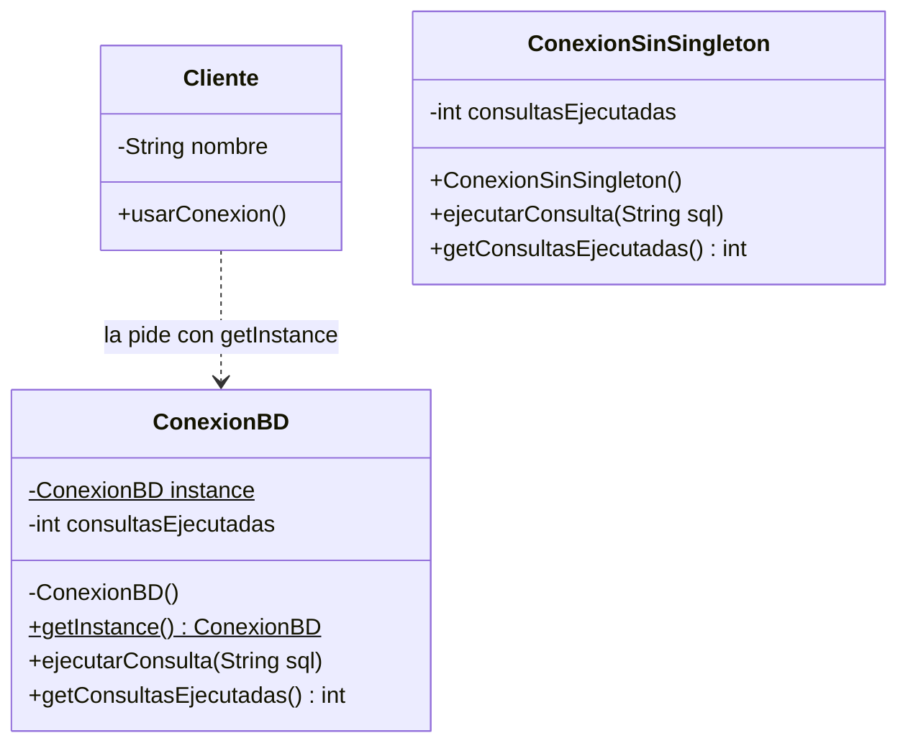

# Patrón Singleton en Java

Ejemplo del patrón de diseño **Singleton**, hecho para la exposición de Ingeniería de Software 2 (Grupo 4).

El ejemplo simula una conexión a una base de datos. Abrir una conexión es costoso, así que lo ideal es abrir una sola y que todo el programa la comparta. El Singleton sirve justo para eso.

## ¿Qué es el patrón Singleton?

Es un patrón creacional que garantiza que una clase tenga **una sola instancia** en todo el programa y que ofrece un **punto de acceso global** a ella.

Para lograrlo, la clase:

1. Tiene el **constructor privado**, para que nadie de afuera pueda hacer `new`.
2. Guarda su única instancia en un **atributo estático** (`instance`).
3. Ofrece un método estático (`getInstance()`) que crea la instancia la primera vez y después siempre devuelve la misma.

## Estructura



## Requisitos

- JDK 17 o superior (se probó con Java 17 y con Java 23).
- Una terminal (PowerShell, CMD, o la terminal de VS Code).

Para revisar que Java está instalado:

```
java -version
javac -version
```

Los dos comandos deben mostrar una versión.

## Cómo ejecutarlo

1. Descargar el proyecto (con `git clone` o con el botón **Code > Download ZIP** de GitHub):

```
git clone https://github.com/nicolasmatheus71/singleton.git
cd singleton
```

2. Compilar todos los archivos (hay que estar dentro de la carpeta del proyecto):

```
javac *.java
```

Si no imprime nada, compiló bien. Se crean unos archivos `.class`, que son normales.

3. Ejecutar el programa:

```
java Main
```

Escribir `Main` con la M mayúscula y sin `.java` al final. El programa se detiene entre un escenario y otro: hay que presionar **Enter** para continuar.

Si se cambia algún archivo, hay que volver a compilar con `javac *.java` antes de ejecutar.

## Qué muestra el programa

El programa corre cuatro escenarios:

**Escenario 1: la misma instancia.** Se pide la conexión dos veces. El mensaje "Conectando a la base de datos..." sale una sola vez y la comparación `a == b` da `true`: las dos variables apuntan al mismo objeto.

**Escenario 2: estado compartido.** Dos clientes distintos ("Usuarios" y "Reportes") usan la conexión. Como es la misma, el contador de consultas es de los dos y al final marca 3.

**Escenario 3: sin Singleton.** Se crean dos conexiones con `new` usando una clase normal. El mensaje "Conectando..." sale dos veces, `c1 == c2` da `false` y cada una cuenta sus consultas por separado.

**Escenario 4: varios hilos.** Se lanzan 5 hilos que piden la conexión al mismo tiempo. Todos reciben el mismo identificador y ninguna de sus consultas se pierde (el contador sube exactamente en 5). Como los hilos corren a la vez, el orden de los mensajes "Ejecutando" puede cambiar en cada ejecución; eso es normal.

Ejemplo de lo que se ve en consola (se omiten los mensajes de "Presione Enter"; el número del identificador cambia en cada ejecución):

```
--- Escenario 1: la misma instancia ---
Conectando a la base de datos...
a == b ? true
Identificador de a: 1421795058
Identificador de b: 1421795058

--- Escenario 2: estado compartido ---
Usuarios pide la conexion...
Ejecutando: SELECT * FROM usuarios
Reportes pide la conexion...
Ejecutando: SELECT * FROM reportes
Usuarios pide la conexion...
Ejecutando: SELECT * FROM usuarios
Total de consultas en la conexion: 3

--- Escenario 3: sin Singleton ---
Conectando a la base de datos...
Conectando a la base de datos...
Ejecutando: SELECT * FROM usuarios
Ejecutando: SELECT * FROM reportes
c1 == c2 ? false
Consultas de c1: 1
Consultas de c2: 1

--- Escenario 4: varios hilos ---
Ejecutando: SELECT * FROM hilo0
Ejecutando: SELECT * FROM hilo4
Ejecutando: SELECT * FROM hilo3
Ejecutando: SELECT * FROM hilo2
Ejecutando: SELECT * FROM hilo1
Hilo 0 recibio el identificador: 1421795058
Hilo 1 recibio el identificador: 1421795058
Hilo 2 recibio el identificador: 1421795058
Hilo 3 recibio el identificador: 1421795058
Hilo 4 recibio el identificador: 1421795058
Todos recibieron la misma instancia ? true
Consultas hechas por los hilos: 5
```

Los mensajes del programa no llevan tildes a propósito, para que se vean bien en cualquier consola de Windows.

## Archivos del proyecto

| Archivo | Para qué sirve |
|---|---|
| `ConexionBD.java` | Es el Singleton. Tiene el constructor privado, la instancia estática y `getInstance()`. |
| `Cliente.java` | Representa una parte del programa que usa la conexión. La pide con `getInstance()`, nunca con `new`. |
| `ConexionSinSingleton.java` | Clase normal, sin el patrón. Solo sirve para comparar en el escenario 3. |
| `Main.java` | Programa principal. Corre los cuatro escenarios. |

Todos los archivos están en la misma carpeta, sin paquetes, para que compilar sea tan simple como `javac *.java`.

## Ventajas y desventajas

**Ventajas**

- Garantiza una sola instancia: no se abren conexiones repetidas ni se desperdician recursos.
- Da un punto de acceso global y controlado a esa instancia.
- La instancia se crea solo cuando se necesita por primera vez (inicialización perezosa).

**Desventajas**

- Es un estado global: las clases que lo usan quedan acopladas a él y sus dependencias no se ven en el constructor.
- Hace dos cosas a la vez: controla su propia instancia y además hace su trabajo (en este caso, ejecutar consultas). Eso va en contra del principio de responsabilidad única (SRP) de SOLID.
- Dificulta las pruebas unitarias, porque es difícil reemplazarlo por un objeto falso.
- Hay que cuidar el acceso desde varios hilos.
- Con reflexión se puede saltar el constructor privado y crear una segunda instancia.

## Nota sobre los hilos

El método `getInstance()` de `ConexionBD` usa una doble verificación con `synchronized` y `volatile`. Así, si dos hilos lo llaman al mismo tiempo, solo uno crea la conexión y el otro encuentra que ya existe. El `volatile` evita que un hilo vea la instancia a medio construir.

Los métodos que usan el contador (`ejecutarConsulta` y `getConsultasEjecutadas`) también son `synchronized`, para que no se pierdan consultas cuando varios hilos comparten la conexión. El escenario 4 lo muestra en funcionamiento.

## Integrantes

- Juan David Guarnizo Martinez
- Nicolas Esteban Matheus Sanchez
- Nicolas Arias Lasprilla
- Ana Maria Luna Escobar
- Juan David Peña Cubillos

## Referencias

- Refactoring Guru, *Singleton*: https://refactoring.guru/design-patterns/singleton
- Freeman, E. y Robson, E., *Head First Design Patterns*, capítulo 5.
